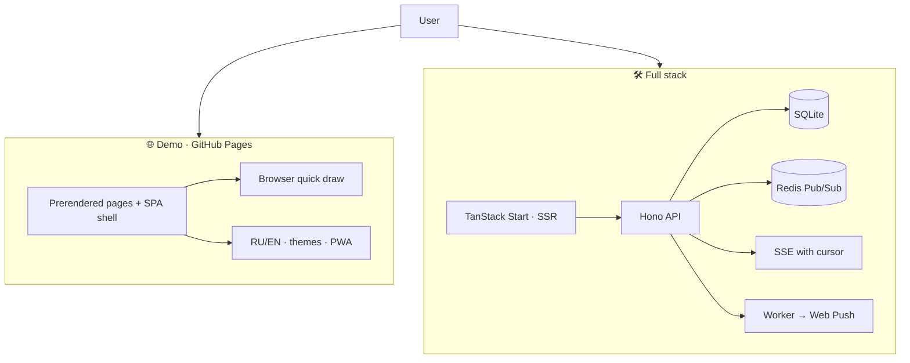

<div align="center">

# 🎁 SecretSanta

**Fair Secret Santa draws with no sign-up: rooms by code, anonymous chat, wishlists, a PWA and three festive themes.**

[](https://github.com/KnowerLife/SecretSanta/actions/workflows/ci-v69.yml)
[](https://knowerlife.github.io/SecretSanta/)
[](https://github.com/KnowerLife/SecretSanta/releases)
[](#pwa-and-offline)
[](#license)

**Language: [🇷🇺 Русский](README.md) · 🇬🇧 English**

**[🎁 Open the demo](https://knowerlife.github.io/SecretSanta/)** · **[Quick start](#quick-start)** · **[Architecture](#architecture-and-data-flow)**

<p align="center">
  
</p>

</div>

---

## Contents

- [Demo and full stack](#demo-and-full-stack)
- [Features](#features)
- [Quick start](#quick-start)
- [Architecture and data flow](#architecture-and-data-flow)
- [Privacy and security](#privacy-and-security)
- [HTTP API](#http-api)
- [PWA and offline](#pwa-and-offline)
- [Localization, themes, accessibility](#localization-themes-accessibility)
- [Artwork](#artwork)
- [Tests and quality](#tests-and-quality)
- [Configuration](#configuration)
- [Releases and rollback](#releases-and-rollback)
- [Repository layout](#repository-layout)
- [Troubleshooting](#troubleshooting)
- [License](#license)

## Demo and full stack

This is one product in two modes. **Pages is a demonstration of the UI and the ideas**; active development and the game logic live in the full server stack.

| | 🌐 Demo on GitHub Pages | 🛠 Full stack |
| :--- | :--- | :--- |
| Where to open | [knowerlife.github.io/SecretSanta](https://knowerlife.github.io/SecretSanta/) | `http://127.0.0.1:3000` + API `:8787` |
| What is available | Home, create/join pages, `/quick-draw`, guides, RU/EN, `winter` / `midnight` / `cozy` themes, PWA | Rooms, draws, SSE, chat, wishlists, offline sync, Web Push |
| Where data lives | In the browser only (localStorage) | SQLite + Redis Pub/Sub + notification worker |
| How it updates | Push to `develop` → demo; push to `main` → stable showcase | Release tags `v*` → images in GHCR |
| What is missing | Server rooms, SSE and push — they need the API | — |

The demo is built with a separate command, `npm run build:pages`: pages are prerendered and unknown paths are handled by an SPA shell. Room links lead to a clear explanation because room bootstrap data comes from the API. See [`docs/GITHUB_PAGES.md`](docs/GITHUB_PAGES.md) for details.

## Features

| Scenario | What happens | Where to try it |
| :--- | :--- | :--- |
| **Play with friends** | Create a room by code, invite participants, exclude unwanted pairs, run the draw | Full stack |
| **Private assignment** | Each participant reveals their recipient personally; the name is absent from public state and SSE events | Full stack |
| **Chat and wishes** | Anonymous chat, wishlists, gift status, event log | Full stack + offline |
| **Quick draw** | Pairs are assigned locally in the browser, with no server or sign-up | [Demo](https://knowerlife.github.io/SecretSanta/quick-draw/) and full stack |
| **Step-by-step guide** | Built-in hints and demo scenes on the create/join pages | Demo and full stack |
| **Offline and notifications** | Offline action queue in localStorage, Web Push reminders 3 days / 1 day / on the event day | Full stack with VAPID |

## Quick start

Requires Node.js `>=22.20.0` and npm. The full production stack also needs Docker with Compose.

### 1. View the demo

Nothing to install: open the [live showcase](https://knowerlife.github.io/SecretSanta/). To build it locally under the repository subpath:

```bash
npm ci
PAGES_BASE=/SecretSanta npm run build:pages
# artifact: apps/web/dist/client
```

### 2. Run the full stack locally

```bash
npm ci
cp .env.example .env
# Set a unique SECRET_SANTA_SECRET (at least 32 characters) and VAPID keys if needed
npm run dev       # SSR: http://127.0.0.1:3000
npm run dev:api   # API: http://127.0.0.1:8787
```

Or bring up API, SSR, worker and Redis in one Compose stack:

```bash
docker compose -f docker-compose.v69.yml up --build
```

Readiness check:

```bash
curl -fsS http://127.0.0.1:8787/api/health
curl -fsS http://127.0.0.1:3000/api/health
```

## Architecture and data flow



| Layer | Stack | Responsibility |
| :--- | :--- | :--- |
| `apps/web` | TanStack Start, React, Mantine, React Query | SSR pages, forms, guides, themes, PWA, static showcase |
| `apps/api` | Hono, SQLite, SSE, ioredis | Rooms, draws, chat, tokens, push, migrations |
| `packages/shared` | TypeScript | Shared contracts and RU/EN dictionary |
| `packages/art` | TypeScript + SVG | Deterministic scenes for the three themes |

Room events are written to `room_events` with a monotonic `rowid` used as the SSE cursor. The subscription is created before replay, so events are neither lost nor duplicated. With `REDIS_URL` set, a broker connects multiple API processes; without it, an in-memory bus serves a single process. The background job in `apps/api/src/worker.ts` handles `notification_jobs` and reminders.

## Privacy and security

- **Assignment only on request.** The recipient's name never appears in SSR markup, public room state or SSE frames; it is revealed only by an explicit participant request with their own token.
- **Tokens instead of accounts.** A room is created by code, mutations require the token issued at join, and revoking a session invalidates the old token.
- **Strict production.** A weak or placeholder `SECRET_SANTA_SECRET` prevents the API from opening its port. A mismatched VAPID pair or invalid `subject` disables push.
- **No secret leaks.** The private VAPID key never appears in logs or API responses.

## HTTP API

| Prefix | Purpose |
| :--- | :--- |
| `/api/health` | API readiness and push status |
| `/api/rooms` | Create, join, state, draw, reset, exclusions, participants |
| `/api/rooms/{code}/assignment` | Current participant's assignment without the recipient's name in public state |
| `/api/rooms/{code}/events` | SSE with a `Last-Event-ID` cursor |
| `/api/push/config`, `/api/push/subscribe` | VAPID configuration and subscription |
| `/api/rooms/demo` | Ready-made demo room for UI checks |

All room mutations require a participant token.

## PWA and offline

The service worker caches the app shell and static SVG scenes, so the app is installable and starts without a network. The offline action queue lives in localStorage and is flushed to the server once connectivity returns. An install banner offers PWA installation, while notification controls appear only when VAPID is configured correctly. Manifest, icon and service worker paths respect the GitHub Pages subpath.

## Localization, themes, accessibility

RU and EN stay in sync — `npm run check:i18n-unused` reports unused keys. Three themes (`winter`, `midnight`, `cozy`) are defined by CSS tokens and shared SVG palettes. Language and theme choices persist in localStorage. The UI supports keyboard navigation, a visible focus state and `prefers-reduced-motion`.

Five focused effects are taken from animate.css: `zoomIn` for the recipient reveal, `fadeInUp` for draw result rows, `headShake` for form errors, `fadeInDown` for confirmations and `pulse` for a completed checklist. Only the used source files are imported, not the whole bundle; see [`docs/MOTION.md`](docs/MOTION.md).

## Artwork

Illustrations are generated in `packages/art` and stored in `apps/web/public/art`. One scene is rendered in three palettes; SVG IDs are made unique on reuse so they do not collide with `aria-labelledby` or gradients. Deterministic rendering produces the same picture in SSR and in the static showcase.

## Tests and quality

```bash
npm run typecheck              # all packages
npm test                       # 66 unit tests across shared/art/api/web and motion checks
npm run check:i18n-unused      # RU/EN dictionary
npm run build                  # API and SSR
npm run build:pages            # static GitHub Pages showcase
npm run verify:frontend:v69    # browser scenarios + Lighthouse, 3 themes × RU/EN
npm audit --audit-level=high   # dependency vulnerabilities
npx openspec validate --all --strict
```

CI on `ubuntu-24.04` runs typechecking, tests, build and OpenSpec validation. `verify:frontend:v69` brings up the Compose stack and checks readiness, the demo, assignment privacy, SSE replay and Lighthouse accessibility. The Pages build is checked in a browser under the `/SecretSanta/` subpath.

## Configuration

Template: `.env.example`. Key variables:

| Variable | Purpose |
| :--- | :--- |
| `SECRET_SANTA_SECRET` | Token signing; at least 32 characters in production, placeholders rejected |
| `VAPID_PUBLIC_KEY`, `VAPID_PRIVATE_KEY`, `VAPID_SUBJECT` | P-256 pair for Web Push; a mismatch disables push |
| `REDIS_URL` | Enables Redis Pub/Sub for SSE across processes |
| `V69_IMAGE_REGISTRY`, `V69_IMAGE_NAMESPACE`, `V69_IMAGE_TAG` | Production image source |
| `PORT` | API port (default `8787`) |
| `PAGES_BASE` | Showcase subpath, e.g. `/SecretSanta`; set automatically by the workflow |
| `VITE_API_BASE` | Optional external API for the showcase; without it the demo stays static |

## Releases and rollback

- **Demo:** `.github/workflows/deploy-pages.yml` publishes the showcase from `develop` and `main`, or manually. No separate Pages tag is needed.
- **Full stack:** `.github/workflows/publish-images.yml` publishes images to GHCR on `v*` tags or manually. Final release: `v9.5.0` (images also tagged `95`); previous known-good: `v69.4.0`; `stable` points to the latest stable release.

```bash
git tag -a v9.5.0 -m "v9.5.0"
git tag -a stable -m "Stable: v9.5.0"
git push origin v9.5.0 stable
docker manifest inspect ghcr.io/<owner>/secret-santa-api:95
```

To roll back, preserve the `v69_api_data` volume, check migration compatibility and recreate the services:

```bash
export V69_IMAGE_TAG=v69.3.0
docker compose -f docker-compose.v69.yml pull api web
docker compose -f docker-compose.v69.yml up -d --no-build --force-recreate
```

Checklist: [`docs/RELEASES.md`](docs/RELEASES.md), branching rules: [`docs/GITFLOW.md`](docs/GITFLOW.md), showcase internals: [`docs/GITHUB_PAGES.md`](docs/GITHUB_PAGES.md).

## Repository layout

```text
apps/api/         Hono API, migrations, worker
apps/web/         TanStack Start, pages, components, styles and Pages config
packages/shared/  Shared contracts and localization
packages/art/     SVG scene generator
scripts/          v69 browser checks and Pages artifact preparation
docs/             GITFLOW, RELEASES, GITHUB_PAGES
openspec/         Specs and change archive
```

## Troubleshooting

- **Ports in use.** SSR uses `3000`, API uses `8787`; change dev server ports or `PORT`.
- **Worker unhealthy in the demo.** Push is disabled with VAPID placeholders — expected; check `push.enabled=false` in `/api/health`.
- **Weak secret.** The API exits before opening its port; set a unique `SECRET_SANTA_SECRET` of at least 32 characters.
- **No SSE events.** Check `REDIS_URL` with multiple processes and the `Last-Event-ID` cursor on reconnect.
- **Room page on Pages shows an explanation.** That is correct: the demo does not run an API; the full game is available in the server stack.

## License

MIT — see [`LICENSE`](LICENSE).
