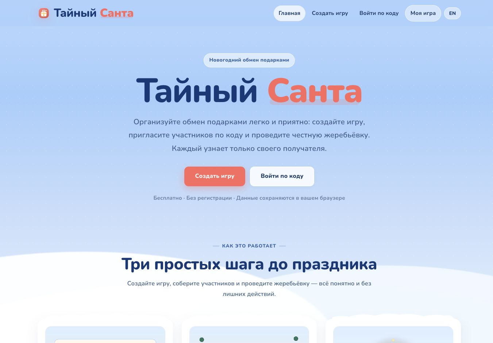
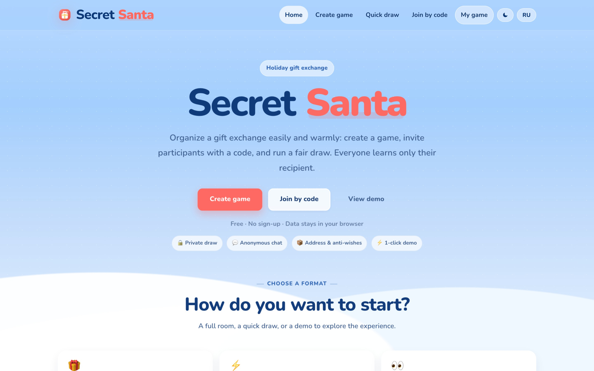

# Тайный Санта / Secret Santa

Современное веб-приложение для организации игры «Тайный Санта»: создание комнаты, приглашение участников по коду, пожелания к подаркам и честная жеребьёвка. Интерфейс выполнен в зимнем праздничном стиле, поддерживает **RU/EN** и работает без регистрации.



## Возможности

- **Быстрый старт** — создание игры за минуту: название, дата обмена, бюджет и тема.
- **Вход по коду** — участники подключаются по коду комнаты, без аккаунтов и email.
- **Честная жеребьёвка** — случайное распределение пар, никто не получает самого себя.
- **Приватный результат** — каждый участник видит только своего получателя.
- **Пожелания к подаркам** — можно добавить wishlist и посмотреть пожелания получателя после жеребьёвки.
- **Статус подготовки** — отслеживание участников, пожеланий и статуса подарка.
- **RU / EN** — переключение языка интерфейса прямо в шапке сайта.
- **PWA-основа** — есть `manifest.webmanifest` и `service worker` для кеширования статики.
- **Локальное хранение** — данные сохраняются в `localStorage` браузера.

## Скриншоты

| Главная | Создание игры | Дашборд игры |
|---|---|---|
|  |  |  |

## Быстрый запуск

### Вариант A: Frontend + Backend (рекомендуется)

```bash
git clone <url-вашего-репозитория>
cd SecretSanta

# Терминал 1: backend API
python3 -m backend.app.server --host 127.0.0.1 --port 8000

# Терминал 2: статический frontend
python3 -m http.server 8766
```

Откройте: `http://localhost:8766`  
Frontend автоматически определит backend на `http://127.0.0.1:8000` и переключится в онлайн-режим (синхронизация комнаты, wishlist, жеребьёвка, SSE-обновления).

### Вариант B: Только frontend (локальный режим)

```bash
python3 -m http.server 8766
```

Данные сохраняются в `localStorage` текущего браузера. Подходит для демо/офлайн.

### Вариант C: Docker Compose

```bash
docker compose up --build
```

- Frontend: `http://localhost:8766`
- Backend: `http://localhost:8000`

## Как начать играть

1. **Создайте игру** — нажмите «Создать игру», заполните название, дату обмена и бюджет.
2. **Поделитесь кодом/ссылкой** — отправьте участникам код комнаты или invite-ссылку.
3. **Участники присоединяются** — вход по коду/ссылке (в онлайн-режиме данные синхронизируются через backend).
4. **Заполните пожелания** — каждый участник добавляет wishlist.
5. **Проведите жеребьёвку** — когда участников минимум 3, организатор запускает draw.
6. **Откройте получателя** — нажмите «Показать, кому я дарю» и подготовьте сюрприз.

## Структура проекта

```text
.
├── index.html                  # Разметка приложения и экраны
├── styles.css                  # Дизайн-система, компоненты, адаптив
├── app.js                      # Frontend: UI, i18n, localStorage, backend API/SSE
├── sw.js                       # Service Worker
├── manifest.webmanifest        # PWA manifest
├── docker-compose.yml          # Локальный запуск frontend + backend
├── .github/workflows/ci.yml    # CI: backend tests + JS syntax check
├── backend/
│   ├── app/                    # Foundation backend (Python stdlib + SQLite)
│   │   ├── server.py           # HTTP API, SSE, auth, draw, wishlist
│   │   ├── db.py               # SQLite + migrations
│   │   ├── auth.py             # Tokens/sessions
│   │   ├── draw.py             # Derangement draw
│   │   ├── realtime.py         # SSE/pubsub helper
│   │   └── push.py             # Web Push scaffold
│   ├── migrations/             # SQL migrations
│   ├── tests/                  # unittest (draw, security, wishlist)
│   ├── Dockerfile
│   └── .env.example
├── backend/prod_stack/         # Каркас миграции на FastAPI + Postgres + Redis
├── assets/images/              # Иллюстрации и промты
└── docs/screenshots/           # Скриншоты для README
```

## Технологии

- **Frontend**: HTML5, CSS3, Vanilla JavaScript, PWA (Manifest + Service Worker), Google Fonts (Nunito).
- **Backend (foundation)**: Python stdlib `http.server`, SQLite, SSE, token-based sessions, server-side draw.
- **Prod stack (scaffold)**: FastAPI, PostgreSQL, SQLAlchemy/Alembic, Redis, worker/notifications.
- **CI**: GitHub Actions (unittest + JS syntax check).

## Конфигурация backend

См. [`backend/.env.example`](backend/.env.example):

- `SECRET_SANTA_SECRET` — секрет подписи токенов (обязательно сменить в production).
- `SECRET_SANTA_DB_PATH` — путь к SQLite.
- `SECRET_SANTA_ALLOW_ORIGIN` — CORS origin.
- `SECRET_SANTA_TOKEN_TTL` — TTL токена.
- `VAPID_*` — опционально для Web Push.

## Примечания

- Frontend поддерживает **два режима**: онлайн (backend) и локальный fallback (`localStorage`).
- Foundation backend уже реализует server-side draw, приватное назначение, wishlist/gift status, SSE, invites/sessions.
- Для полноценного production остаются: полноценный UI управления invite/session, hardening безопасности/rate limiting, миграция на `backend/prod_stack` (Postgres/Redis/worker), e2e и наблюдаемость.

## Лицензия

Проект распространяется под лицензией [MIT](LICENSE).

---

# Secret Santa / Тайный Санта

A modern web app for organizing a Secret Santa gift exchange: create a room, invite participants with a code, collect gift wishes, and run a fair draw. The interface features a winter holiday style, supports **RU/EN**, and works without registration.



## Features

- **Quick start** — create a game in a minute: name, exchange date, budget, and theme.
- **Join by code** — participants join with a room code, no accounts or email required.
- **Fair draw** — random pair assignment where no one gets themselves.
- **Private result** — each participant sees only their own recipient.
- **Gift wishes** — add a wishlist and view the recipient’s wishes after the draw.
- **Preparation status** — track participants, wishes, and gift readiness.
- **RU / EN** — switch the interface language directly in the header.
- **PWA basics** — includes `manifest.webmanifest` and a `service worker` for static asset caching.
- **Local storage** — data is saved in the browser’s `localStorage`.

## Screenshots

| Home | Create game | Game dashboard |
|---|---|---|
|  |  |  |

## Quick Start

### Option A: Frontend + Backend (recommended)

```bash
git clone <your-repository-url>
cd SecretSanta

# Terminal 1: backend API
python3 -m backend.app.server --host 127.0.0.1 --port 8000

# Terminal 2: static frontend
python3 -m http.server 8766
```

Open: `http://localhost:8766`  
The frontend auto-detects the backend at `http://127.0.0.1:8000` and switches to online mode (room sync, wishlist, draw, SSE updates).

### Option B: Frontend only (local mode)

```bash
python3 -m http.server 8766
```

Data is stored in the current browser’s `localStorage`. Good for demo/offline use.

### Option C: Docker Compose

```bash
docker compose up --build
```

- Frontend: `http://localhost:8766`
- Backend: `http://localhost:8000`

## How to Start Playing

1. **Create a game** — click “Create game”, fill in the name, exchange date, and budget.
2. **Share the code/link** — send the room code or invite link to participants.
3. **Participants join** — join by code/link (in online mode data syncs through backend).
4. **Fill in wishes** — each participant adds a wishlist.
5. **Run the draw** — when there are at least 3 participants, the organizer runs the draw.
6. **Reveal your recipient** — click “Show who I’m gifting to” and prepare a surprise.

## Project Structure

```text
.
├── index.html                  # App markup and screens
├── styles.css                  # Design system, components, responsive styles
├── app.js                      # Frontend: UI, i18n, localStorage, backend API/SSE
├── sw.js                       # Service Worker
├── manifest.webmanifest        # PWA manifest
├── docker-compose.yml          # Local frontend + backend run
├── .github/workflows/ci.yml    # CI: backend tests + JS syntax check
├── backend/
│   ├── app/                    # Foundation backend (Python stdlib + SQLite)
│   │   ├── server.py           # HTTP API, SSE, auth, draw, wishlist
│   │   ├── db.py               # SQLite + migrations
│   │   ├── auth.py             # Tokens/sessions
│   │   ├── draw.py             # Derangement draw
│   │   ├── realtime.py         # SSE/pubsub helper
│   │   └── push.py             # Web Push scaffold
│   ├── migrations/             # SQL migrations
│   ├── tests/                  # unittest (draw, security, wishlist)
│   ├── Dockerfile
│   └── .env.example
├── backend/prod_stack/         # FastAPI + Postgres + Redis migration scaffold
├── assets/images/              # Illustrations and prompts
└── docs/screenshots/           # README screenshots
```

## Tech Stack

- **Frontend**: HTML5, CSS3, Vanilla JavaScript, PWA (Manifest + Service Worker), Google Fonts (Nunito).
- **Backend (foundation)**: Python stdlib `http.server`, SQLite, SSE, token-based sessions, server-side draw.
- **Prod stack (scaffold)**: FastAPI, PostgreSQL, SQLAlchemy/Alembic, Redis, worker/notifications.
- **CI**: GitHub Actions (unittest + JS syntax check).

## Backend Configuration

See [`backend/.env.example`](backend/.env.example):

- `SECRET_SANTA_SECRET` — token signing secret (must be changed in production).
- `SECRET_SANTA_DB_PATH` — SQLite path.
- `SECRET_SANTA_ALLOW_ORIGIN` — CORS origin.
- `SECRET_SANTA_TOKEN_TTL` — token TTL.
- `VAPID_*` — optional Web Push config.

## Notes

- The frontend supports **two modes**: online (backend) and local fallback (`localStorage`).
- The foundation backend already implements server-side draw, private assignment, wishlist/gift status, SSE, invites/sessions.
- Remaining for full production: full invite/session management UI, security/rate-limiting hardening, migration to `backend/prod_stack` (Postgres/Redis/worker), e2e tests, and observability.

## License

This project is licensed under the [MIT](LICENSE) license.
