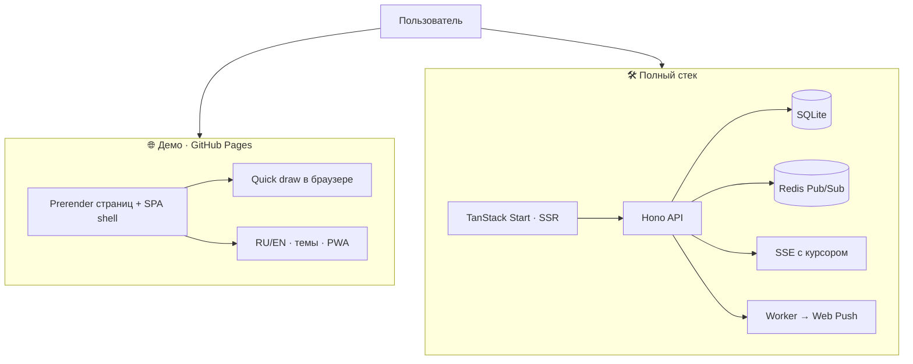

<div align="center">

# 🎁 SecretSanta

**Честная жеребьёвка «Тайного Санты» без регистрации: комнаты по коду, анонимный чат, вишлисты, PWA и три праздничные темы.**

[](https://github.com/KnowerLife/SecretSanta/actions/workflows/ci-v69.yml)
[](https://knowerlife.github.io/SecretSanta/)
[](https://github.com/KnowerLife/SecretSanta/releases)
[](#pwa-и-офлайн)
[](#лицензия)

**Язык: 🇷🇺 Русский · [🇬🇧 English](README.en.md)**

**[🎁 Открыть демо](https://knowerlife.github.io/SecretSanta/)** · **[Быстрый старт](#быстрый-старт)** · **[Архитектура](#архитектура-и-поток-данных)**

<p align="center">
  
</p>

</div>

---

## Содержание

- [Демо и полный стек](#демо-и-полный-стек)
- [Возможности](#возможности)
- [Быстрый старт](#быстрый-старт)
- [Архитектура и поток данных](#архитектура-и-поток-данных)
- [Приватность и безопасность](#приватность-и-безопасность)
- [HTTP API](#http-api)
- [PWA и офлайн](#pwa-и-офлайн)
- [Локализация, темы, доступность](#локализация-темы-доступность)
- [Графика](#графика)
- [Тесты и качество](#тесты-и-качество)
- [Конфигурация](#конфигурация)
- [Релизы и откат](#релизы-и-откат)
- [Структура репозитория](#структура-репозитория)
- [Устранение проблем](#устранение-проблем)
- [Лицензия](#лицензия)

## Демо и полный стек

Это один продукт в двух режимах. **Pages — демонстрация интерфейса и идей**, основная разработка и игровая логика живут в полном серверном стеке.

| | 🌐 Демо на GitHub Pages | 🛠 Полный стек |
| :--- | :--- | :--- |
| Где открыть | [knowerlife.github.io/SecretSanta](https://knowerlife.github.io/SecretSanta/) | `http://127.0.0.1:3000` + API `:8787` |
| Что доступно | Главная, страницы create/join, `/quick-draw`, гиды, RU/EN, темы `winter` / `midnight` / `cozy`, PWA | Комнаты, жеребьёвка, SSE, чат, вишлисты, офлайн-синхронизация, Web Push |
| Где живут данные | Только в браузере (localStorage) | SQLite + Redis Pub/Sub + воркер уведомлений |
| Обновление | Push в `develop` → демо; push в `main` → стабильная витрина | Релизные теги `v*` → образы в GHCR |
| Чего нет | Серверных комнат, SSE и push — для них нужен API | — |

Демо собирается отдельной командой `npm run build:pages`: страницы prerender'ятся, а неизвестные пути открываются через SPA-оболочку. Ссылки на комнаты ведут на понятное пояснение, потому что bootstrap комнаты приходит от API. Подробности — [`docs/GITHUB_PAGES.md`](docs/GITHUB_PAGES.md).

## Возможности

| Сценарий | Что происходит | Где попробовать |
| :--- | :--- | :--- |
| **Игра с друзьями** | Создать комнату по коду, пригласить участников, исключить нежелательные пары, провести жеребьёвку | Полный стек |
| **Приватное назначение** | Участник сам открывает своего получателя; в публичных данных и SSE его имени нет | Полный стек |
| **Общение и пожелания** | Анонимный чат, вишлисты, статус подарка, журнал событий | Полный стек + офлайн |
| **Быстрая жеребьёвка** | Пары раздаются локально в браузере, без сервера и регистрации | [Демо](https://knowerlife.github.io/SecretSanta/quick-draw/) и полный стек |
| **Гид по шагам** | Встроенные подсказки и демо-сцены на страницах create/join | Демо и полный стек |
| **Офлайн и уведомления** | Очередь действий в localStorage, Web Push с напоминаниями за 3 дня / 1 день / в день события | Полный стек с VAPID |

## Быстрый старт

Требуются Node.js `>=22.20.0` и npm. Для полного production-стека — Docker с Compose.

### 1. Посмотреть демо

Ничего устанавливать не нужно: откройте [живую витрину](https://knowerlife.github.io/SecretSanta/). Чтобы собрать её локально под подпуть репозитория:

```bash
npm ci
PAGES_BASE=/SecretSanta npm run build:pages
# артефакт: apps/web/dist/client
```

### 2. Запустить полный стек локально

```bash
npm ci
cp .env.example .env
# Задайте уникальный SECRET_SANTA_SECRET (минимум 32 символа) и при необходимости VAPID-ключи
npm run dev       # SSR: http://127.0.0.1:3000
npm run dev:api   # API: http://127.0.0.1:8787
```

Или одним Compose-стеком с API, SSR, воркером и Redis:

```bash
docker compose -f docker-compose.v69.yml up --build
```

Проверка готовности:

```bash
curl -fsS http://127.0.0.1:8787/api/health
curl -fsS http://127.0.0.1:3000/api/health
```

## Архитектура и поток данных



| Слой | Стек | Ответственность |
| :--- | :--- | :--- |
| `apps/web` | TanStack Start, React, Mantine, React Query | SSR-страницы, формы, гиды, темы, PWA, статическая витрина |
| `apps/api` | Hono, SQLite, SSE, ioredis | Комнаты, жеребьёвка, чат, токены, push, миграции |
| `packages/shared` | TypeScript | Общие контракты и словарь RU/EN |
| `packages/art` | TypeScript + SVG | Детерминированные сцены для трёх тем |

События комнаты пишутся в `room_events` с монотонным `rowid`, который служит курсором SSE. Подписка создаётся до replay, поэтому события не теряются и не дублируются. При заданном `REDIS_URL` брокер соединяет несколько процессов API; без него работает in-memory шина одного процесса. Фоновая задача `apps/api/src/worker.ts` обрабатывает `notification_jobs` и напоминания.

## Приватность и безопасность

- **Назначение — только по действию.** Имя получателя не попадает в SSR-разметку, публичное состояние комнаты и SSE-кадры; его раскрывает явный запрос участника со своим токеном.
- **Токены вместо аккаунтов.** Комната создаётся по коду, доступ к мутациям даёт токен, выданный при входе; отзыв сессии аннулирует старый токен.
- **Строгий production.** При слабом или заглушечном `SECRET_SANTA_SECRET` API не открывает порт. Несовпадение VAPID-пары или некорректный `subject` отключают push.
- **Секреты не утекают.** Приватный VAPID-ключ не попадает в логи и ответы API.

## HTTP API

| Префикс | Назначение |
| :--- | :--- |
| `/api/health` | Готовность API и статус push |
| `/api/rooms` | Создание, вход, состояние, жеребьёвка, сброс, исключения, participants |
| `/api/rooms/{code}/assignment` | Назначение текущего участника без имени получателя в публичных данных |
| `/api/rooms/{code}/events` | SSE с курсором `Last-Event-ID` |
| `/api/push/config`, `/api/push/subscribe` | VAPID-конфигурация и подписка |
| `/api/rooms/demo` | Готовая демо-комната для проверки интерфейса |

Все мутации комнаты требуют токен участника.

## PWA и офлайн

Service worker кэширует оболочку и статические SVG-сцены, обеспечивая установку приложения и запуск без сети. Очередь офлайн-действий хранится в localStorage и отправляется на сервер после восстановления связи. Баннер предлагает установку PWA, а кнопки уведомлений появляются только при рабочей VAPID-конфигурации. Пути манифеста, иконок и service worker'а учитывают подпуть GitHub Pages.

## Локализация, темы, доступность

RU и EN синхронизированы — `npm run check:i18n-unused` сообщает о неиспользуемых ключах. Три темы (`winter`, `midnight`, `cozy`) задаются CSS-токенами и общими SVG-палитрами. Выбор языка и темы сохраняется в localStorage. Интерфейс поддерживает клавиатурную навигацию, видимый фокус и `prefers-reduced-motion`.

Из animate.css взято пять точечных эффектов: `zoomIn` при раскрытии получателя, `fadeInUp` для строк жеребьёвки, `headShake` для ошибок форм, `fadeInDown` для подтверждений и `pulse` для завершённого чек-листа. Подключены только используемые исходники, а не весь бандл; подробности — [`docs/MOTION.md`](docs/MOTION.md).

## Графика

Иллюстрации генерируются из `packages/art` и лежат в `apps/web/public/art`. Одна сцена рендерится в трёх палитрах; при повторном использовании идентификаторы SVG делаются уникальными, чтобы не конфликтовать с `aria-labelledby` и градиентами. Детерминированный рендер позволяет получить одинаковую картинку в SSR и статической витрине.

## Тесты и качество

```bash
npm run typecheck              # все пакеты
npm test                       # 66 unit-тестов shared/art/api/web и motion-проверок
npm run check:i18n-unused      # словарь RU/EN
npm run build                  # API и SSR
npm run build:pages            # статическая витрина GitHub Pages
npm run verify:frontend:v69    # браузерные сценарии + Lighthouse, 3 темы × RU/EN
npm audit --audit-level=high   # уязвимости зависимостей
npx openspec validate --all --strict
```

CI на `ubuntu-24.04` прогоняет типопроверку, тесты, сборку и валидацию OpenSpec; `verify:frontend:v69` поднимает Compose-стек и проверяет готовность, демо, приватность назначения, SSE replay и доступность Lighthouse. Pages-сборка проверяется браузером на подпути `/SecretSanta/`.

## Конфигурация

Шаблон — `.env.example`. Ключевые переменные:

| Переменная | Назначение |
| :--- | :--- |
| `SECRET_SANTA_SECRET` | Подпись токенов; в production минимум 32 символа, заглушки запрещены |
| `VAPID_PUBLIC_KEY`, `VAPID_PRIVATE_KEY`, `VAPID_SUBJECT` | Пара P-256 для Web Push; несовпадение ключей отключает push |
| `REDIS_URL` | Включает Redis Pub/Sub для SSE между процессами |
| `V69_IMAGE_REGISTRY`, `V69_IMAGE_NAMESPACE`, `V69_IMAGE_TAG` | Источник образов production-стека |
| `PORT` | Порт API (по умолчанию `8787`) |
| `PAGES_BASE` | Подпуть витрины, например `/SecretSanta`; workflow задаёт автоматически |
| `VITE_API_BASE` | Необязательный внешний API для витрины; без него демо остаётся статическим |

## Релизы и откат

- **Демо:** workflow `.github/workflows/deploy-pages.yml` публикует витрину из `develop` и `main` или вручную. Отдельный тег для Pages не нужен.
- **Полный стек:** `.github/workflows/publish-images.yml` публикует образы в GHCR по тегу `v*` или вручную. Final-релиз — `v9.5.0` (образы также с тегом `95`), предыдущий рабочий — `v69.4.0`; тег `stable` указывает на последний стабильный релиз.

```bash
git tag -a v9.5.0 -m "v9.5.0"
git tag -a stable -m "Stable: v9.5.0"
git push origin v9.5.0 stable
docker manifest inspect ghcr.io/<владелец>/secret-santa-api:95
```

Для отката сохраните том `v69_api_data`, проверьте совместимость миграций и пересоздайте сервисы:

```bash
export V69_IMAGE_TAG=v69.3.0
docker compose -f docker-compose.v69.yml pull api web
docker compose -f docker-compose.v69.yml up -d --no-build --force-recreate
```

Чеклист — [`docs/RELEASES.md`](docs/RELEASES.md), правила веток — [`docs/GITFLOW.md`](docs/GITFLOW.md), устройство витрины — [`docs/GITHUB_PAGES.md`](docs/GITHUB_PAGES.md).

## Структура репозитория

```text
apps/api/         Hono API, миграции, воркер
apps/web/         TanStack Start, страницы, компоненты, стили и Pages-конфиг
packages/shared/  Контракты и локализация
packages/art/     Генератор SVG-сцен
scripts/          Браузерные проверки v69 и подготовка Pages-артефакта
docs/             GITFLOW, RELEASES, GITHUB_PAGES
openspec/         Спецификации и архив изменений
```

## Устранение проблем

- **Порты заняты.** SSR использует `3000`, API — `8787`; измените порты в конфигурации dev-серверов или `PORT`.
- **Воркер unhealthy в демо.** При VAPID-заглушках push отключён — это ожидаемо; проверьте `push.enabled=false` в `/api/health`.
- **Слабый секрет.** API завершится до открытия порта; задайте уникальный `SECRET_SANTA_SECRET` длиной от 32 символов.
- **Нет событий SSE.** Проверьте `REDIS_URL` при нескольких процессах и курсор `Last-Event-ID` при переподключении.
- **Страница комнат на Pages показывает пояснение.** Это корректно: демо не запускает API, полная игра доступна в серверном стеке.

## Лицензия

MIT — см. [`LICENSE`](LICENSE).
