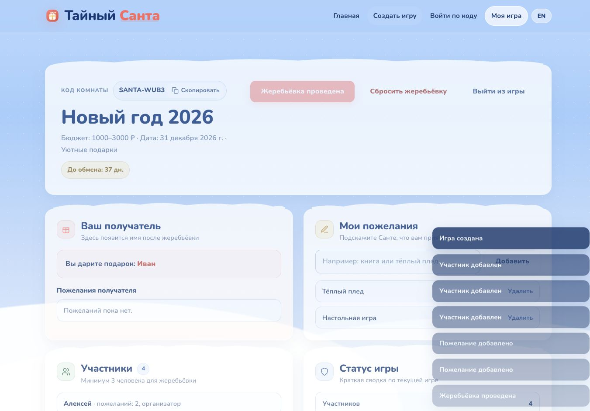

# Тайный Санта / Secret Santa

Современное веб-приложение для организации игры «Тайный Санта»: создание комнаты, приглашение участников по коду, пожелания к подаркам и честная жеребьёвка. Интерфейс выполнен в зимнем праздничном стиле, поддерживает **RU/EN** и работает без регистрации.


## Возможности

- **Быстрый старт** — создание игры за минуту: название, дата обмена, бюджет и тема.
- **Вход по коду** — участники подключаются по коду комнаты, без аккаунтов и email.
- **Честная жеребьёвка** — случайное распределение пар, никто не получает самого себя.
- **Приватный результат** — каждый участник видит только своего получателя.
- **Пожелания к подаркам** — можно добавить wishlist и посмотреть пожелания получателя после жеребьёвки.
- **Статус подготовки** — отслеживание участников, пожеланий и статуса подарка.
- **RU / EN** — переключение языка интерфейса прямо в шапке сайта.
- **PWA-основа** — есть `manifest.webmanifest` и `service worker` для кеширования статики.
- **Локальное хранение** — данные сохраняются в `localStorage` браузера.

## Скриншоты

| Главная | Создание игры | Дашборд игры |
|---|---|---|
|  |  |  |

## Быстрый запуск

Проект статический: сборка не требуется.

### 1. Клонировать репозиторий

```bash
git clone <url-вашего-репозитория>
cd SecretSanta
```

### 2. Запустить локальный сервер

Любой статический сервер подойдёт. Например:

```bash
python3 -m http.server 8766
```

После запуска откройте в браузере:

```text
http://localhost:8766
```

> Можно использовать и другой порт/сервер (`npx serve`, VS Code Live Server и т.д.). Главное — открывать проект через HTTP, а не напрямую через `file://`.

## Как начать играть

1. **Создайте игру** — нажмите «Создать игру», заполните название, дату обмена и бюджет.
2. **Поделитесь кодом комнаты** — отправьте код участникам.
3. **Добавьте участников** — участники могут войти по коду или организатор может добавить их вручную в дашборде.
4. **Заполните пожелания** — каждый участник добавляет wishlist, чтобы упростить выбор подарка.
5. **Проведите жеребьёвку** — когда участников минимум 3, нажмите «Провести жеребьёвку».
6. **Откройте получателя** — нажмите «Показать, кому я дарю» и подготовьте сюрприз.

## Структура проекта

```text
.
├── index.html                  # Разметка приложения и все экраны
├── styles.css                  # Дизайн-система, компоненты, адаптив
├── app.js                      # Логика игры, i18n, localStorage, UI-состояния
├── sw.js                       # Service Worker для кеширования
├── manifest.webmanifest        # PWA manifest
├── icons/
│   └── icon.svg                # Иконка приложения
├── assets/
│   └── images/                 # Иллюстрации и промты для графики
│       ├── PROMPTS.md
│       ├── hero-winter-scene.jpg
│       ├── step-create-game.jpg
│       ├── step-invite-friends.jpg
│       ├── step-draw-gifts.jpg
│       └── dashboard-empty.jpg
├── docs/
│   └── screenshots/            # Скриншоты для README
└── backend/                    # Черновая backend-основа/эксперименты (не нужна для статического запуска)
```

## Технологии

- **HTML5** — семантическая разметка экранов и форм.
- **CSS3** — кастомные свойства, адаптивная сетка, визуальные состояния, анимации.
- **Vanilla JavaScript** — состояние приложения, жеребьёвка, i18n, работа с DOM и `localStorage`.
- **PWA basics** — Web App Manifest + Service Worker.
- **Google Fonts** — Nunito.

## Примечания

- Текущая версия фронтенда хранит данные **локально в браузере**. Для совместного использования между разными устройствами нужен серверный backend/синхронизация.
- Папка `backend/` содержит заготовки и эксперименты и не требуется для базового запуска интерфейса.

## Лицензия

Проект распространяется под лицензией [MIT](LICENSE).
