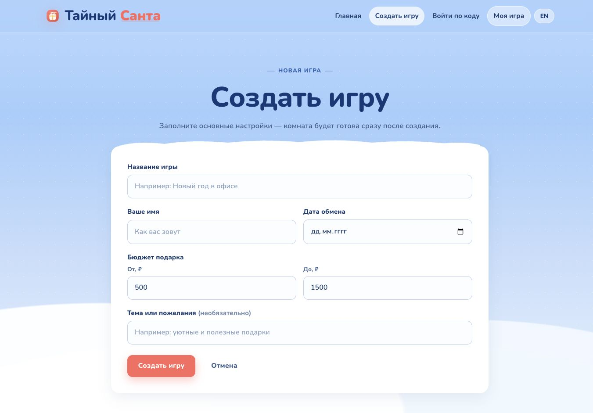
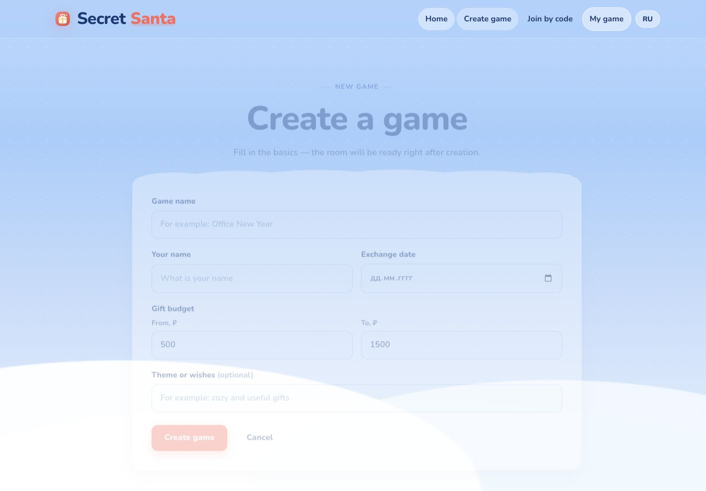
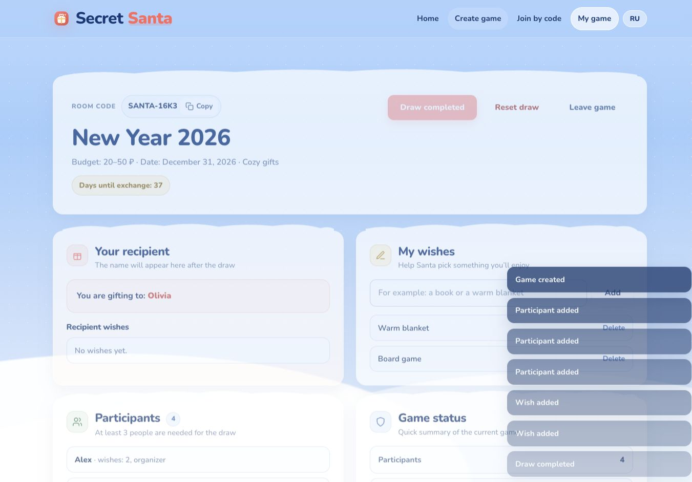

# Тайный Санта / Secret Santa

Современное веб-приложение для организации игры «Тайный Санта»: создание комнаты, приглашение участников по коду, пожелания к подаркам и честная жеребьёвка. Интерфейс выполнен в зимнем праздничном стиле, поддерживает **RU/EN** и работает без регистрации.


## Возможности

- **Быстрый старт** — создание игры за минуту: название, дата обмена, бюджет и тема.
- **Вход по коду** — участники подключаются по коду комнаты, без аккаунтов и email.
- **Честная жеребьёвка** — случайное распределение пар, никто не получает самого себя.
- **Приватный результат** — каждый участник видит только своего получателя.
- **Пожелания к подаркам** — можно добавить wishlist и посмотреть пожелания получателя после жеребьёвки.
- **Статус подготовки** — отслеживание участников, пожеланий и статуса подарка.
- **RU / EN** — переключение языка интерфейса прямо в шапке сайта.
- **PWA-основа** — есть `manifest.webmanifest` и `service worker` для кеширования статики.
- **Локальное хранение** — данные сохраняются в `localStorage` браузера.

## Скриншоты

| Главная | Создание игры | Дашборд игры |
|---|---|---|
|  |  |  |

## Быстрый запуск

Проект статический: сборка не требуется.

### 1. Клонировать репозиторий

```bash
git clone <url-вашего-репозитория>
cd SecretSanta
```

### 2. Запустить локальный сервер

Любой статический сервер подойдёт. Например:

```bash
python3 -m http.server 8766
```

После запуска откройте в браузере:

```text
http://localhost:8766
```

> Можно использовать и другой порт/сервер (`npx serve`, VS Code Live Server и т.д.). Главное — открывать проект через HTTP, а не напрямую через `file://`.

## Как начать играть

1. **Создайте игру** — нажмите «Создать игру», заполните название, дату обмена и бюджет.
2. **Поделитесь кодом комнаты** — отправьте код участникам.
3. **Добавьте участников** — участники могут войти по коду или организатор может добавить их вручную в дашборде.
4. **Заполните пожелания** — каждый участник добавляет wishlist, чтобы упростить выбор подарка.
5. **Проведите жеребьёвку** — когда участников минимум 3, нажмите «Провести жеребьёвку».
6. **Откройте получателя** — нажмите «Показать, кому я дарю» и подготовьте сюрприз.

## Структура проекта

```text
.
├── index.html                  # Разметка приложения и все экраны
├── styles.css                  # Дизайн-система, компоненты, адаптив
├── app.js                      # Логика игры, i18n, localStorage, UI-состояния
├── sw.js                       # Service Worker для кеширования
├── manifest.webmanifest        # PWA manifest
├── icons/
│   └── icon.svg                # Иконка приложения
├── assets/
│   └── images/                 # Иллюстрации и промты для графики
│       ├── PROMPTS.md
│       ├── hero-winter-scene.jpg
│       ├── step-create-game.jpg
│       ├── step-invite-friends.jpg
│       ├── step-draw-gifts.jpg
│       └── dashboard-empty.jpg
├── docs/
│   └── screenshots/            # Скриншоты для README
└── backend/                    # Черновая backend-основа/эксперименты (не нужна для статического запуска)
```

## Технологии

- **HTML5** — семантическая разметка экранов и форм.
- **CSS3** — кастомные свойства, адаптивная сетка, визуальные состояния, анимации.
- **Vanilla JavaScript** — состояние приложения, жеребьёвка, i18n, работа с DOM и `localStorage`.
- **PWA basics** — Web App Manifest + Service Worker.
- **Google Fonts** — Nunito.

## Примечания

- Текущая версия фронтенда хранит данные **локально в браузере**. Для совместного использования между разными устройствами нужен серверный backend/синхронизация.
- Папка `backend/` содержит заготовки и эксперименты и не требуется для базового запуска интерфейса.

## Лицензия

Проект распространяется под лицензией [MIT](LICENSE).

---

# Secret Santa / Тайный Санта

A modern web app for organizing a Secret Santa gift exchange: create a room, invite participants with a code, collect gift wishes, and run a fair draw. The interface features a winter holiday style, supports **RU/EN**, and works without registration.


## Features

- **Quick start** — create a game in a minute: name, exchange date, budget, and theme.
- **Join by code** — participants join with a room code, no accounts or email required.
- **Fair draw** — random pair assignment where no one gets themselves.
- **Private result** — each participant sees only their own recipient.
- **Gift wishes** — add a wishlist and view the recipient’s wishes after the draw.
- **Preparation status** — track participants, wishes, and gift readiness.
- **RU / EN** — switch the interface language directly in the header.
- **PWA basics** — includes `manifest.webmanifest` and a `service worker` for static asset caching.
- **Local storage** — data is saved in the browser’s `localStorage`.

## Screenshots

| Home | Create game | Game dashboard |
|---|---|---|
|  |  |  |

## Quick Start

The project is static: no build step required.

### 1. Clone the repository

```bash
git clone <your-repository-url>
cd SecretSanta
```

### 2. Start a local server

Any static server will work. For example:

```bash
python3 -m http.server 8766
```

Then open in your browser:

```text
http://localhost:8766
```

> You can use another port/server (`npx serve`, VS Code Live Server, etc.). The main thing is to open the project over HTTP, not directly via `file://`.

## How to Start Playing

1. **Create a game** — click “Create game”, fill in the name, exchange date, and budget.
2. **Share the room code** — send the code to participants.
3. **Add participants** — participants can join by code, or the organizer can add them manually in the dashboard.
4. **Fill in wishes** — each participant adds a wishlist to make gift choosing easier.
5. **Run the draw** — when there are at least 3 participants, click “Run draw”.
6. **Reveal your recipient** — click “Show who I’m gifting to” and prepare a surprise.

## Project Structure

```text
.
├── index.html                  # App markup and all screens
├── styles.css                  # Design system, components, responsive styles
├── app.js                      # Game logic, i18n, localStorage, UI state
├── sw.js                       # Service Worker for caching
├── manifest.webmanifest        # PWA manifest
├── icons/
│   └── icon.svg                # App icon
├── assets/
│   └── images/                 # Illustrations and graphic prompts
│       ├── PROMPTS.md
│       ├── hero-winter-scene.jpg
│       ├── step-create-game.jpg
│       ├── step-invite-friends.jpg
│       ├── step-draw-gifts.jpg
│       └── dashboard-empty.jpg
├── docs/
│   └── screenshots/            # README screenshots
└── backend/                    # Draft backend foundation/experiments (not needed for static run)
```

## Tech Stack

- **HTML5** — semantic markup for screens and forms.
- **CSS3** — custom properties, responsive layout, visual states, animations.
- **Vanilla JavaScript** — app state, draw logic, i18n, DOM and `localStorage`.
- **PWA basics** — Web App Manifest + Service Worker.
- **Google Fonts** — Nunito.

## Notes

- The current frontend version stores data **locally in the browser**. For cross-device shared use, a backend/sync layer is needed.
- The `backend/` folder contains drafts and experiments and is not required for the basic frontend run.

## License

This project is licensed under the [MIT](LICENSE) license.
